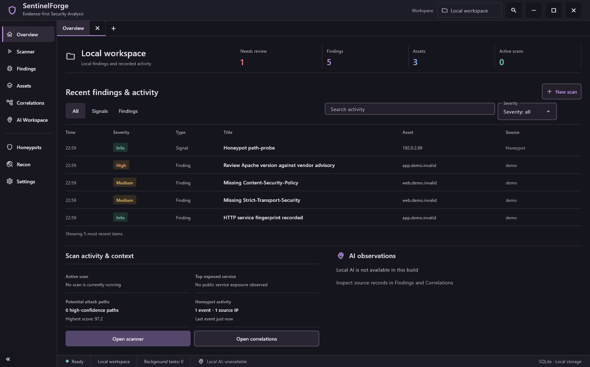

# SentinelForge

SentinelForge is a desktop toolkit for scanning services, reviewing findings and keeping security evidence together in a home lab or small network

Use Python 3.11 to 3.13
The project is pre-release, with desktop checks on Windows and Python 3.13
Use it on systems you own or have permission to assess



Demo records in the current desktop UI

## What works

- TCP scanning, lightweight UDP probes and service fingerprinting, with optional Nmap and Nikto support
- Recon for DNS, RDAP, subdomains and HTTP technology hints
- HTTP, SSH, FTP, Telnet and SMTP honeypots
- Asset and finding review, local vulnerability-feed imports and ranked evidence paths
- Desktop tool tabs, keyboard navigation and a CLI

A service banner or advisory match is evidence to investigate, not confirmation that a target is exploitable

## Install and run

From the repository root in PowerShell:

```powershell
python -m venv .venv
.\.venv\Scripts\python.exe -m pip install .
$env:SF_DATA_DIR = Join-Path $env:LOCALAPPDATA "SentinelForge"
.\.venv\Scripts\sentinelforge-ui.exe
```

`SF_DATA_DIR` holds configuration, SQLite data and default exports
Set it in each terminal before starting the app or CLI
Changing this path does not move existing data

The package includes the font, warning sound and bundled lookup data
Install Nmap or Nikto separately if you want to use those engines
Optional packet libraries are available with `.\.venv\Scripts\python.exe -m pip install ".[packet]"`; PyShark capture remains unfinished

## CLI

```powershell
.\.venv\Scripts\sentinelforge.exe doctor
.\.venv\Scripts\sentinelforge.exe scan 127.0.0.1 --ports 22,80,443
.\.venv\Scripts\sentinelforge.exe export --format json
```

Run `doctor` to check the environment and optional tools
Public scan targets are blocked by default; configure the allowlist and scope settings before scanning external assets
Feed imports read local files, and the bundled demo cache is not a current vulnerability feed

## Reports and current limits

Export TXT, JSON, CSV, HTML, Markdown, SARIF or STIX from the UI or CLI
Report exports include the full inventory and ignore the current view filters
They have no fixed row cap, though large exports still need enough memory to build the report

JSON retains the report payload
STIX uses Notes for findings and inventory context, with linked CVEs represented as Vulnerability objects
Readable reports and interchange formats publish different views of the same data

Switching tools resets filters and unsaved forms while backend jobs keep running
Jobs do not survive an application restart
Local AI and separate project workspaces are not implemented

See [ROADMAP.md](ROADMAP.md) for the next work and [CHANGELOG.md](CHANGELOG.md) for recent changes
